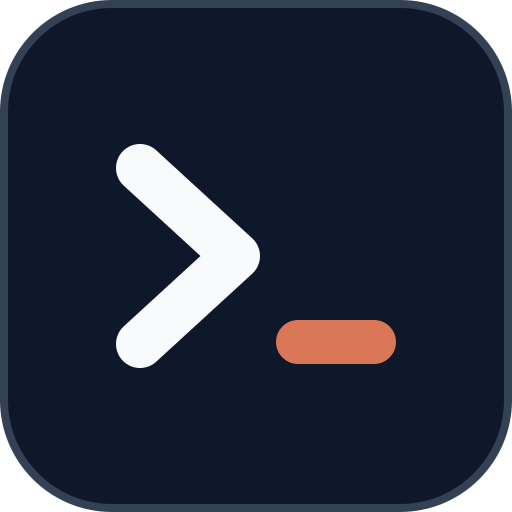

# Contributing

Thank you for helping improve Deckhand.

| [README](README.md) | **Contributing** | [Security](SECURITY.md) | [Changelog](CHANGELOG.md) |
| :---: | :---: | :---: | :---: |

The READMEs come in five languages. This contribution policy is canonical in English.

## Before you start

- Open an issue first for a new button, a new delegate CLI, a change to what leaves the user's machine, or a large change to the band.
- Keep one pull request focused on one outcome.
- Never commit credentials, tokens, private prompts, conversation history, personal email addresses or absolute home paths.
- Report vulnerabilities privately, as described in [SECURITY.md](SECURITY.md).

## Development setup

Requirements:

- Python 3.9 or newer, with no third-party packages;
- git;
- Claude Code with plugin hook modules, to try the band itself;
- optional: `gh`, `codex`, Cursor `agent` and `agy`, to try watches and delegates.

The plugin lives in [`plugins/deckhand`](plugins/deckhand). Run the local baseline from the repository root:

```bash
(cd plugins/deckhand && python3 -m unittest discover -s tests -p 'test_*.py')
python3 -m unittest discover -s scripts -p 'test_*.py'
python3 scripts/scan-secrets.py
python3 scripts/check-version.py
python3 scripts/check-attribution.py
git diff --check
```

The TypeScript hook tests (`plugins/deckhand/tests/deckhand.test.ts`) run inside Claude Code's plugin test runner. With Claude Code and TypeScript installed:

```bash
claude plugin test plugins/deckhand
claude plugin validate --strict plugins/deckhand
claude plugin validate --strict .
tsc -p plugins/deckhand
```

`tsc` needs the engine types in `plugins/deckhand/.claude-plugin/types/`. They are gitignored, and Claude Code writes them when it loads the plugin.

CI runs:

- the Python tests on Python 3.9 and 3.12;
- the secret scan and the version check;
- `claude plugin validate --strict` (plugin and marketplace) and `claude plugin test` on Claude Code 2.1.299, the oldest version the plugin supports (the first that loads a hooks module split across files), and on `latest` as an early warning that does not fail the run;
- `tsc -p plugins/deckhand` with the engine types of Claude Code 2.1.292.

None of these needs a login or an API key. CI makes the engine types with `claude -p ok --plugin-dir plugins/deckhand`: Claude Code 2.1.292 writes them when it loads the plugin, then stops at "Not logged in". Claude Code 2.1.295 and 2.1.299 no longer write them in that run, so the type check stays on 2.1.292's types even though the plugin needs 2.1.299. If a later version is needed and does not write them, remove the type check from CI and run `tsc` locally. The generated `claude-code-mcp` types declare no MCP tools, so in CI the inputs of the `mcp__deckhand__*` tools are loosely typed.

## Code layout

`plugins/deckhand/hooks/register.tsx` is the hooks module Claude Code loads. It wires the session start, the Bash guards, the translate and search tools and the routing text, and calls one `register…` function per part:

| File | Part |
| --- | --- |
| `band.tsx` | The band above the prompt |
| `settings-pane.tsx` | The settings pane, the settings file, and redoing what a changed setting affects |
| `session.ts` | What a session registers: commands, the Sub5 worker, the translate and search tools, the CLI check, the update notice |
| `actions.ts` | The Sub5 and delegate buttons, and the hand-over to the main agent |
| `delegates.tsx` | Delegate runs in the band, and the records pane |
| `models.tsx` | The usage readout and the model buttons |
| `watches.tsx` | The deploy watch, engine side |
| `handoff.tsx` | Claude ↔ Codex handoff and the Codex inbox |
| `leftovers.tsx` | Sub5 leftovers and their pane |
| `galaxy.tsx` | Intent Galaxy: finding its tools, the install pane, Deckhand's own pair of tools (run through `bin/galaxy.py`), the iG hand-over, and the row while a galaxy waits |
| `about.ts` | The About tab: versions, the release check on demand, diagnostics to copy |
| `recap.tsx` | Recap |
| `core.ts` | Settings and language, shared by every part |

The other files in `hooks/` hold pure logic with tests of their own. Claude Code reads each file of a hooks module on its own, so a split has to keep three rules, or the module does not load. Claude Code before 2.1.299 refuses `$` across any import, so the split needs 2.1.299 or later:

1. An atom is read and updated only in the file that declares it. Other files call that file's functions.
2. `$` and `on` reach another file only through a function declaration (`export async function name($: Engine)`), never an arrow function.
3. A hook matcher names a constant of its own file (`requestId: SETTINGS_PANE`). `claude plugin validate` shows a matcher it cannot read as `?`.

## Secret scan

`scripts/scan-secrets.py` scans every git-tracked file, or the paths you pass. It reports private keys, provider tokens, `KEY`/`SECRET`/`TOKEN`/`PASSWORD` assignments with real-looking values, credentials in URLs, email addresses and absolute home paths. It prints `file:line` and a masked preview, and exits with 1 when it finds something.

It also checks for terms that only exist on your machine and are never stored in the repository: your OS user name, your `git config --global user.email`, and the lines of an untracked file you pass with `--deny-file`:

```bash
python3 scripts/scan-secrets.py --deny-file ~/.config/deckhand-deny.txt
python3 scripts/scan-secrets.py --include-untracked   # also new files you have not added yet
```

A test fixture that needs a fake secret can carry the marker `scan-secrets: allow` on the same line. Use it only for fake values. The marker never hides a deny-term hit.

## Version check

The version appears in eight places: `plugins/deckhand/.claude-plugin/plugin.json`, the deckhand entry in `.claude-plugin/marketplace.json`, the version badge in the five READMEs, and the newest `## X.Y.Z — date` heading in `CHANGELOG.md`. `scripts/check-version.py` prints each place that differs from `plugin.json` and exits with 1. At a release, also check the new number:

```bash
python3 scripts/check-version.py --expect 1.1.0
```

## Attribution check

GitHub lists every author and co-author of a commit on `main` as a contributor. A commit made by a Claude Code cloud session is authored by `Claude <noreply@anthropic.com>` and carries `Co-Authored-By` and `Claude-Session` trailers. `scripts/check-attribution.py` reads every commit reachable from `HEAD` (or a range you pass, such as `origin/main..HEAD`) and fails on an `@anthropic.com` author or committer, a co-author trailer naming Claude, a session trailer, or a "Generated with Claude Code" line. A human co-author is fine. To fix a refused commit, set yourself as its author and drop the trailers before merging:

```bash
git commit --amend --reset-author
```

## Change rules

1. Delegates stay read-only. A new delegate CLI needs its own read-only flag or mode, the secret check, and tests that prove both.
2. Exact git work belongs in scripts such as `bin/sub5.py`, not in prompts. Never push, never force a dirty worktree, and delete a branch only after verifying its work is integrated.
3. Anything that sends data off the machine must be named in the README's "Privacy and safety" section.
4. A user-facing string ships in every locale: `hooks/i18n/<locale>.ts` for the hooks and `bin/locales/<locale>.json` for the scripts, 41 locales listed in `hooks/locales.ts` and `bin/i18n.py`. Write English, 繁體中文 (Taiwan), 简体中文, 日本語 and 한국어 yourself; the other locales may be machine-translated with the locale's own developer-tool wording, and a message a JSON catalog lacks falls back to English. Use the wording native speakers use in developer tools, not a word-for-word translation. Keep commands, paths and identifiers unchanged.
5. Bound every repetition in a regular expression that reads user text (`{1,64}`, not `+`), so a long line cannot cause catastrophic backtracking.
6. Keep runtime state outside the repository.
7. Add a test for every new guard, including the case it must refuse.

When you change the README, update all five language versions, or open an issue for the translations you could not do.

## Pull request checklist

- [ ] Scope and non-goals are explicit.
- [ ] Behavior and safety boundaries are documented.
- [ ] Focused tests cover success and failure paths.
- [ ] The Python tests pass on Python 3.9.
- [ ] `python3 scripts/scan-secrets.py`, `python3 scripts/check-version.py` and `git diff --check` pass.
- [ ] User-facing text is updated in every locale.
- [ ] No secrets, private state or personal data are included.

Small, reviewable commits are preferred. Do not combine unrelated cleanup with a behavior change.

By contributing, you agree that your contribution is licensed under the [MIT License](LICENSE).
